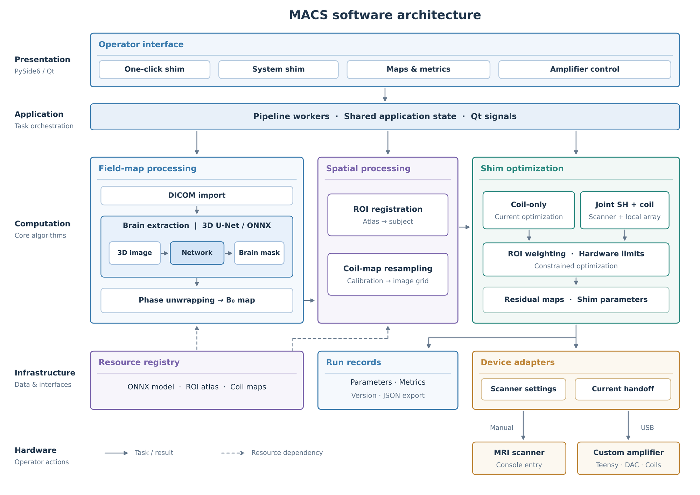
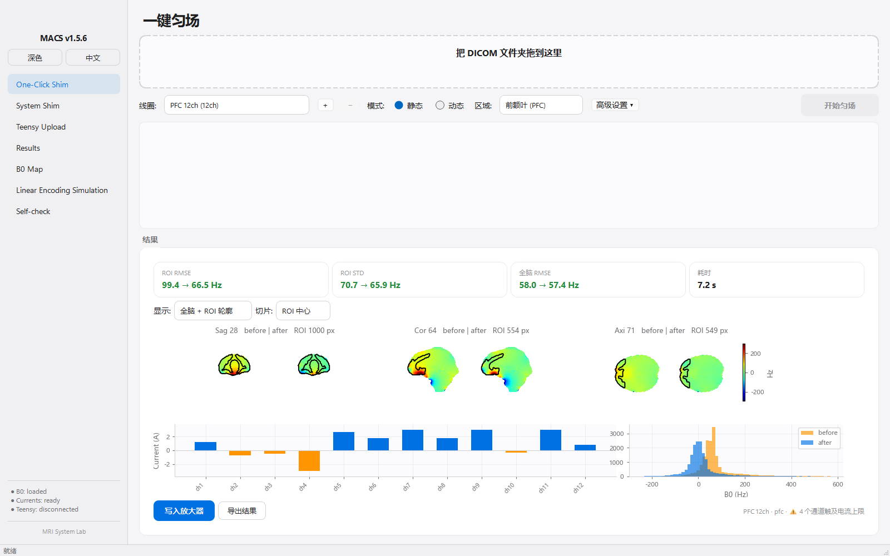

# MACS: Multi-channel Active Coil Shimming

One-click B0 shimming for MRI that jointly optimises the scanner's spherical
harmonic (SH) shim and a local multi-channel shim array. All coil arrays go
through **one shared pipeline**. Adding a new array means adding a folder of
per-channel field maps and a small JSON file. No code changes are needed.

```
DICOM ──► pair series ──► Δf0 ──► 3D U-Net brain mask ──► phase unwrap ──► ΔB0 (Hz)
                                                                          │
           atlas target region (e.g. PFC) registered to the subject ──────┤
                                                                          ▼
          coil registry (any array) ──► constrained joint optimisation: scanner SH + N channels
                                                                          │
                                             console SH values + per-channel currents (A)
```





*One-click page after a run with the 12-channel PFC array: target-region and whole-brain metrics, before/after field maps in three planes, per-channel currents and the field histogram.*

## Coil arrays included

| Config | Array | Channels | Field maps |
|---|---|---|---|
| `config/coils/pfc_12ch.json` | Prefrontal surface array, 5 T brain | 12 | `coils/pfc_12ch/` |
| `config/coils/sf_12ch.json` | Surface array, 2025-12-04 calibration | 12 | `coils/sf_12ch/` |
| `config/coils/infant_36ch.json` | Infant head AC/DC array (RF + shim), 3 T | 36 | `coils/infant_36ch/` |

Each array folder holds one `ch{N}_nii/ch{N}_nii_deltaFieldmap.nii.gz` per
channel. Every config carries a `field_unit_status`. Runs that depend on the
absolute field unit stay disabled until the status for **that specific array**
is `user_confirmed`. A confirmation never carries over to another array based
on channel count or name.

### Adding your own array

1. Put one field map per channel at `coils/<name>/ch1_nii/…`, `ch2_nii/…`, …
2. Copy one of the JSON files in `config/coils/`, then edit `name`,
   `channel_count`, `fieldmap_dir` and `current_limit_a`.
3. Check that it is discovered:
   `python -c "from core import coil_registry as r; print(r.discover_report())"`

You can also import an array from the GUI. Imported arrays are stored under
`~/.macs/`.

## Repository layout

```
main.py               entry point (PySide6 desktop application)
core/                 pipeline, B0 calculation, registration, joint solvers, coil registry
widgets/ workers/     Qt pages and background workers
config/coils/         one JSON per coil array
coils/                per-channel field maps (NIfTI, Hz/A)
atlases/              MNI152 1 mm brain + PFC target mask
cpp_bet/              prebuilt brain-extraction module + bet_micro.onnx model
test_dic/             de-identified 5 T demo B0 field map (DICOM) for an end-to-end run
tests/                test suite
tools/                packaging, BET verification and research scripts
```

## Running

Requires Python 3.10–3.12 on Windows (the primary target).

```bash
pip install -r requirements.txt
python main.py            # or double-click start.bat
python -m pytest tests    # test suite
python tests/test_pipeline.py   # DICOM -> currents on the demo data
```

Brain extraction in the one-click pipeline uses `cpp_bet`, a C++ 3D U-Net
running on ONNX Runtime on the CPU. The prebuilt module in `cpp_bet/` targets
**Python 3.11, Windows x64**, and ships with ONNX Runtime 1.28 and the
`bet_micro.onnx` model, so no build step is needed. On any other Python
version, the pipeline falls back to HD-BET (`pip install hd-bet`). If neither
is available, the run stops with an error. A lower-accuracy threshold mask is
used only when `MACS_ALLOW_OTSU_BET=1` is set.

A Windows executable can be built with `build.bat` (PyInstaller, `macs.spec`).

## Hardware

Currents are uploaded to a Teensy-based multi-channel shim amplifier over
serial at 115200 baud.

## Data

Apart from the de-identified demo field map in `test_dic/` (see its README), this repository contains **no subject data**. Subject identifiers that appear
in comments and in pre-registration records have been replaced with
pseudonyms (`S01`…). The atlas files are derived from the MNI152 template and
the Harvard-Oxford atlas. The brain-extraction model is distilled from HD-BET
(Apache-2.0). ONNX Runtime (MIT) and zlib (zlib license) are redistributed as
binaries. Their license texts are in `third_party_licenses/`.

## Citation

If you use this code, please cite the accompanying ISMRM abstract (citation
to be added).
